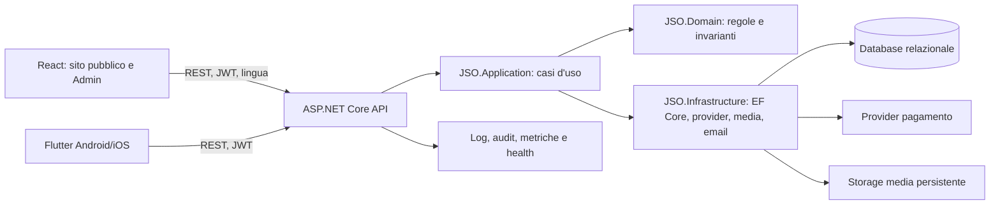

# JSO Web — architettura e audit tecnico

**Data:** 19 ottobre 2026  
**Branch/commit controllato:** `main` / `1ed34f6`  
**Perimetro:** repository, frontend, API/backend, app Flutter, test e configurazione di build. L'ambiente di produzione e i servizi Render non erano accessibili per una verifica autenticata: i risultati descrivono il codice e i test locali, non certificano il deploy.

## Sintesi per il team

Il repository ha una base valida e adatta a un club: monorepo, web React, API .NET e app Flutter che condividono contratti HTTP. I moduli sono già organizzati per funzionalità e il backend separa Domain, Application, Infrastructure e API. Non serve introdurre microservizi o riscrivere tutto.

La priorità professionale è rendere affidabile il percorso completo **utente/admin → API → database → pagamento/verifica → ricevuta**, uniformare la navigazione web, poi rifinire l'architettura per estrazioni incrementali. Prima del rilascio servono verifiche reali di provider di pagamento, persistenza media, backup/restore, permessi e dispositivi mobili.

## Architettura osservata e direzione raccomandata

**Principi:** mantenere il monolite modulare; un solo sistema di route per il frontend; DTO/API documentati e versionati; controller sottili; casi d'uso applicativi testabili; regole e invarianti nel dominio; adapter per database, storage e pagamenti; autorizzazione sempre lato API; log correlabili con un identificativo richiesta; migrazioni e immagini container riproducibili.

## Squadra e responsabilità

| Ruolo | Responsabilità |
|---|---|
| Team leader / coordinamento (root) | priorità, integrazione dei rilievi, criteri di completamento e release gate |
| Architetto software (revisione architetturale) | confini tra moduli, routing, evoluzione applicativa e deployment |
| Revisore frontend | rotte account, UX/responsive, accessibilità, bundle e test web |
| Revisore backend | API, database, pagamenti, concorrenza e sicurezza |
| QA integrato | test automatici, smoke test e tracciabilità dei flussi end-to-end |

Le revisioni sono state svolte in parallelo su codice condiviso e senza modifiche indipendenti da integrare. La squadra ha prodotto rilievi; l'implementazione e la decisione finale restano coordinate dal team leader.

## Esito dei controlli eseguibili

| Controllo | Esito |
|---|---|
| Test frontend `node --test` | 15/15 superati |
| Test backend .NET Release | 107/107 superati |
| Lint frontend | esito 0, con warning da correggere |
| Build frontend Vite | completata nel controllo precedente delle modifiche account; da ripetere dopo ogni patch finale |
| Flutter test/build | non eseguibile qui: CLI Flutter non installato |
| Produzione / Render | non verificabile con sessione disponibile |

## Rilievi prioritari

### P1 — Integrità prenotazioni e codici promo

`TicketsController.Reserve` legge disponibilità e numero di utilizzi promo prima di incrementare i contatori e salvare l'ordine. Il controllo e gli aggiornamenti non risultano protetti da aggiornamento atomico/concorrente. Due richieste contemporanee possono entrambe superare il controllo iniziale e vendere oltre la capacità o il limite d'uso promo. Aggiungere una transazione con vincoli/aggiornamenti condizionali atomici e test concorrenti sul provider relazionale usato in produzione.

### P1 — Una sola fonte di routing web

`frontend/src/main.jsx` seleziona pagine con `window.location`, `frontend/src/App.jsx` contiene un secondo dispatcher, e alcune schermate consultano direttamente il pathname. Questo rende più fragile back/forward, deep link e test delle rotte. Consolidare gradualmente su un router unico, preservando gli URL pubblici attuali e verificando refresh su ogni route.

### P1 — Verifica di produzione e transazioni di pagamento

I test automatici non verificano credenziali reali, webhook pubblici, CORS del dominio live, persistenza degli upload, backup/restore o permessi configurati sul servizio. Prima del rilascio aggiungere una checklist di smoke test sul flusso biglietto, donazione cash, pagamento online, webhook, ricevuta e scansione QR, inclusi i casi falliti/duplicati.

### P2 — Schermate account e carico API

Le route dedicate `/account/tickets`, `/memberships`, `/orders`, `/supports` e `/payments` esistono e hanno un test di risoluzione. La pagina però carica ancora i dati di più aree insieme e usa classi CSS per nascondere i pannelli non selezionati. Renderizzare solo la sezione richiesta e richiedere solo i dati necessari; questo riduce lavoro e accoppiamento e rende le route pagine autonome anche a livello di componenti.

### P2 — Accessibilità menu mobile

Il menu account mobile modifica direttamente la classe DOM e non espone lo stato `aria-expanded`, né la relazione con il pannello. Gestire lo stato React, associare `aria-controls`, chiudere con Escape e al cambio di route, e verificare tastiera/screen reader.

### P2 — Responsabilità troppo concentrate

`Program.cs` è circa 292 righe; `AdminApp.jsx` circa 311; `CustomerDashboardPage.jsx` circa 247. Alcuni controller tickets/donations/payments concentrano query, regole di flusso e HTTP. Estrarre per passi: registrazioni middleware/servizi, moduli di pagina e casi d'uso applicativi, con test e senza cambiare i contratti esistenti.

### P2 — Build riproducibile e warning

`Dockerfile.frontend` usa `npm install`, mentre il build root usa `npm ci`. Usare `npm ci` nel container e controllare il lockfile per ottenere build identiche. Il lint termina con warning (import inutilizzato e chiavi duplicate in traduzioni): eliminarli e rendere il lint un gate senza warning.

### P2 — Stato documentale/deployment

`docs/IMPLEMENTATION_STATUS.md` dichiara data 30 settembre 2026 e distingue correttamente codice da produzione, ma README e documenti deployment citano destinazioni diverse. Aggiornare una matrice canonica per ambiente (locale, staging, produzione), database, storage, URL, provider e owner; aggiornare lo stato solo dopo prove ripetibili.

## Roadmap proposta

1. **Affidabilità (prima del prossimo rilascio):** correggere concorrenza ticket/promo; ripulire lint; build Docker deterministica; test di regressione per account e promo.
2. **Percorsi critici:** test end-to-end autenticazione → acquisto → webhook → account → QR; donazione cash → conferma Admin → dashboard utente; controllo autorizzazioni admin.
3. **Web architecture:** router unico; pagine account con caricamento dati per sezione; menu accessibile; client API centralizzato per auth, lingua, errori e abort.
4. **Backend modularità:** spostare la logica business dei controller in use case Application; invarianti di capacità/pagamento nel dominio o nei servizi applicativi; separare configurazione `Program.cs` per moduli.
5. **Go-live:** accesso a Render, smoke test live, controllo logs/health, backup e restore provati, media persistenti, verifica di Android/iOS su dispositivi reali.

## Criteri per dichiarare il sito pronto

- build web e container ripetibile dal lockfile;
- test frontend/backend verdi e Flutter verificato in CI con SDK supportato;
- test concorrenti non superano capacità né limite promo;
- tutti i link diretti e refresh account/Admin funzionano;
- ogni ruolo vede e può eseguire solo le azioni autorizzate dall'API;
- webhook idempotenti e pagamento/QR riconciliati con i record DB;
- test live di pagamenti, email, upload, backup/restore e health documentati;
- test responsive e accessibilità sui flussi pubblici e account.
